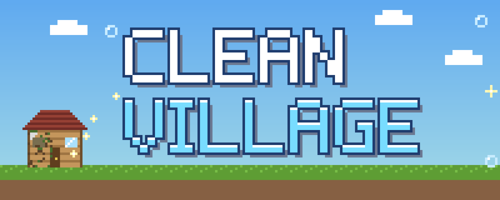
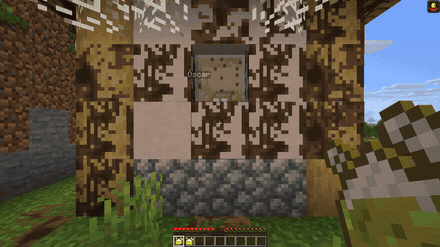
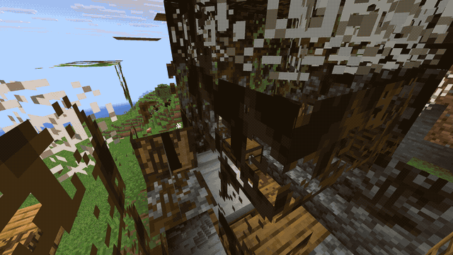
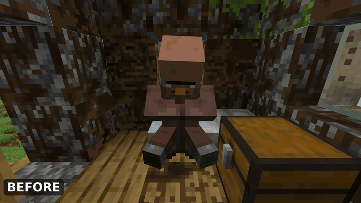

<p align="center"></p>

# Clean Village

Some village houses are filthy, and their owner sits on the edge of the bed, heartbroken. Grab the soapy sponge from the chest, scrub every stain, cobweb and patch of mold, and watch the villager come home, jump with joy to a little jingle and throw you a hand-written thank-you letter and a reward.


<p align="center"> </p>

<p align="center"></p>

▶️ Trailer: [`media/trailer.mp4`](media/trailer.mp4)

## How to play

1. **Find a dirty house.** In about 60% of newly generated villages, 1–2 houses are covered in grime: dirty walls, fogged windows, mold in the corners and dusty cobwebs. Inside, the owner sits on the bed, head down, crying.
2. **Read the book** in the chest next to the bed: it tells you what happened to the house. The chest also has two **Soapy Sponges**.
3. **Scrub.** Hold **right click** (or left click) with the sponge on any dirt. Each stroke removes one layer, with bubbles, sound and a little sparkle when the block is clean. A progress bar ("Marta's house: 37%") appears while you are inside.
4. **Recharge** the sponge when it dries out: right click on water.
5. **Celebrate.** At 100% the house shines, the lights come back, the villager walks in, looks around and jumps with hearts while a jingle plays. Everyone who helped gets a signed thank-you letter, emeralds and maybe gold or a diamond, a decorative **Family Portrait**, *Hero of the Village* for 40 minutes and a permanent reputation boost with the owner.

Crafting the sponge for your own base: **yellow wool + slime ball** (shapeless).

## Features

- Works with all 5 vanilla village types; dirt is applied on top of the existing vanilla houses (compatible with other village mods, no structure files replaced).
- Dirt can't be broken with a pickaxe or blown up: it has to be cleaned.
- Progress uses a counter, not a scan: no TPS cost.
- Multiplayer-ready: anyone can help; every helper gets their own letter and reward. Sounds, particles and animations are server-side and visible to everyone nearby.
- The owner is invulnerable during the quest (configurable), won't trade while sad, and talks to you instead.
- 5 languages: English, Spanish, French, German, Italian. The game uses the player's language and falls back to English.

## Configuration

`config/cleanvillage.json` (created on first launch):

| Key | Default | Meaning |
| --- | --- | --- |
| `villageChance` | `0.6` | Chance that a new village gets dirty houses |
| `minHouses` / `maxHouses` | `1` / `2` | Dirty houses per selected village |
| `onlyNewVillages` | `true` | Skip villages players already visited |
| `invulnerableOwner` | `true` | Owner can't die during the quest |
| `heroLevel` / `heroMinutes` | `1` / `40` | Hero of the Village reward |
| `unitsPerExtraRoll` / `maxLootRolls` | `40` / `4` | Bigger houses roll the reward table more times |
| `ambientSounds` | `true` | Dripping and distant rain inside dirty houses |

The reward is a data-pack loot table: `data/cleanvillage/loot_table/gameplay/house_reward.json` (override it in a datapack).

## Commands (operators)

`/cleanvillage list | info | tp <id> | where <id> | verify <id> | phase <id> <sad|cleaning|celebrating|done> | scrub <id> <n> | complete <id> | remove <id> | here | village | testhouse`

## Requirements

- Minecraft **26.3** (Java 25)
- **Fabric** Loader ≥ 0.19.3 + Fabric API, **NeoForge** 26.3 or **Forge** 66 (26.3)

## Building

The project is split like an Architectury multiloader project (`common/`, `fabric/`, `neoforge/`, `forge/`). Minecraft 26.x is not obfuscated, so the mod compiles directly against the game jar with no remapping:

```
python3 tools/gen_assets.py <unzipped client jar> <folder with vanilla lang jsons>   # textures, models, lang, data
python3 tools/gen_logo.py                                                           # logo, banner, mod icon
python3 tools/fetch_libs.py libs   # downloads Minecraft, Fabric, NeoForge and Forge compile jars
CLEANVILLAGE_LIBS=libs python3 build.py   # -> build/libs/cleanvillage-{fabric,neoforge,forge}-<version>.jar
python3 build.py --dev      # same + dev-only script runner used for automated in-game tests
```

**GitHub Actions** (`.github/workflows/build.yml`) does this on every push and pull request and uploads the three jars as the `cleanvillage-jars` artifact. Pushing a tag such as `v1.0.0` also creates a GitHub release with the jars attached.

`tools/harness.py` runs a headless Fabric server with the mod and a list of console commands (used by the validator agent in `.claude/agents/`).

## License

MIT © Joel Cardona

### Store media

`python3 tools/make_media.py <captures dir>` rebuilds the stills, GIFs and the trailer in `media/` from in-game captures taken with the dev script runner (`python3 build.py --dev`).
