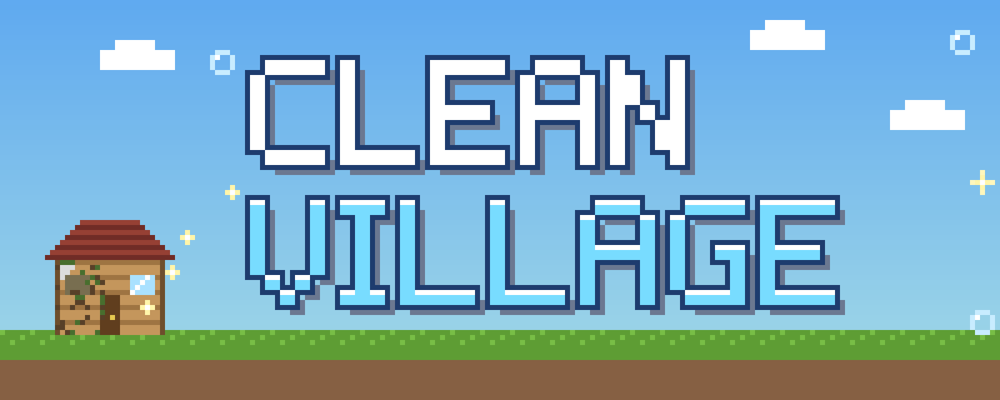
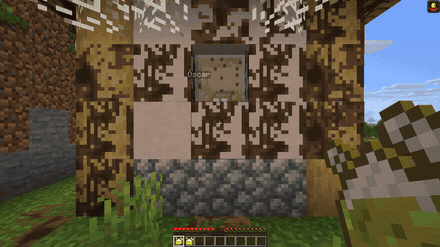
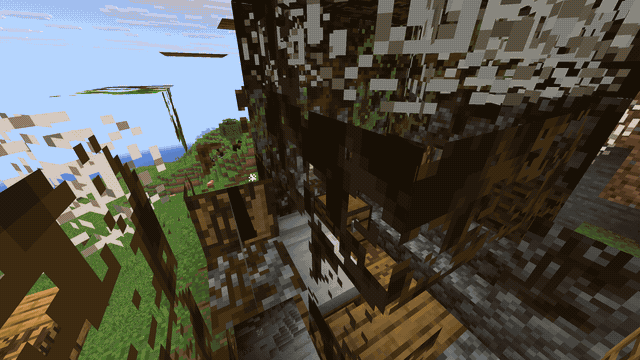

<!--
CURSEFORGE PROJECT SETUP (paste the body below into the Markdown description editor)
Project name ..... Clean Village
Summary .......... Clean up filthy village houses with a soapy sponge, cheer up their heartbroken owners and get thanked.
Categories ....... Main: Adventure and RPG · Extra: Structures, Cosmetic
Loaders .......... Fabric, NeoForge, Forge · Minecraft 26.3
Logo ............. media/icon.png (square, 400x400 recommended)
Images tab ....... upload everything listed in docs/gallery.md with the same titles/descriptions
Relations ........ Fabric build: "Required Dependency" → Fabric API
License .......... MIT
Trailer ...... media/trailer.mp4 → upload to YouTube and paste the link (Modrinth: "Video" in the description; CurseForge: Images tab › Videos)
-->

## Some village houses are filthy, and their owner is heartbroken.

Grab a **Soapy Sponge**, scrub every stain, cobweb and patch of mold, and watch them come home, jump with joy and thank you with a hand-written letter.

---

### 🏚️ How it plays

1. **Discover.** In villages you haven't spent time in yet, 1–2 houses are covered in grime, mold, fogged windows and dusty cobwebs. The lights are out, and the owner sits on the edge of the bed, head down, crying.
2. **Read their story.** The chest next to the bed holds two sponges and a book explaining what happened: a flood, a chimney fire, a spider invasion, a pillager raid…
3. **Scrub.** Hold right click with the sponge on any dirt. Bubbles, a scrubbing sound and a little sparkle when each block comes clean. A boss bar shows how much is left.
4. **They're watching.** As soon as you start, the owner stands up and waits by the door. At 50% they peek in.
5. **Celebrate.** At 100% the whole house shines, the lights come back on, and the villager walks in, looks around and jumps for joy to a little tune.
6. **Get thanked.** Every helper receives a signed thank-you letter, emeralds (with luck, gold or a diamond), a decorative **Family Portrait**, *Hero of the Village* and a lasting discount with that villager.

### 🧽 One tool. No tutorial needed.

- **Use it:** hold right click on dirt (left click works too).
- **Dry?** Right click on any water to soak it again.
- **Need more?** Two come in the house chest, or craft one from **yellow wool + slime ball**.

### ✨ Features

- Six backstories, each with its own thank-you letter.
- Works with all five vanilla village types: plains, desert, savanna, taiga and snowy.
- The dirt can't be mined, pushed by pistons or blown up. You have to clean it.
- Multiplayer friendly: anyone can help, and everyone who helped gets rewarded.
- Lightweight: progress is tracked with a counter instead of scanning blocks.
- Configurable in `config/cleanvillage.json` (chance per village, houses per village, rewards…). The reward is a normal loot table you can override with a data pack.
- English, Español, Français, Deutsch, Italiano. Uses your game language and falls back to English.

### 📦 Installation

- **Fabric:** Fabric Loader 0.19+ and **Fabric API**
- **NeoForge:** NeoForge 26.3
- **Forge:** Forge 66 for 26.3

Install on both client and server. Existing worlds work: dirty houses appear in villages players haven't spent time in yet.

### ❓ FAQ

**I can't find a dirty house.** About 60% of villages get one (configurable), and only villages nobody has spent more than a few minutes in. Travel to a village you haven't visited. Operators can run `/cleanvillage village` next to a village.

**Can I change the rewards?** Yes: override `data/cleanvillage/loot_table/gameplay/house_reward.json` in a data pack.

**Is it compatible with other village mods?** It only touches houses from vanilla village structures. Other mods' buildings are left alone.

---

*Made by Joel Cardona · MIT License · All textures and sounds are original or vanilla.*
