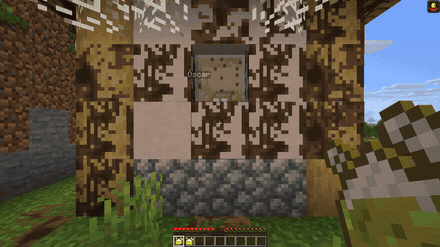
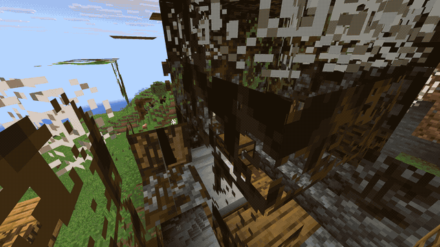

<!--
MODRINTH PROJECT SETUP
Name ........ Clean Village
Summary ..... Some village houses are filthy and their owner is heartbroken. Grab a soapy sponge, scrub the house spotless and watch the villager celebrate.
Categories .. Adventure, Decoration, Game Mechanics (+ tag: Worldgen)
Environment . Client: required · Server: required
Loaders ..... Fabric (needs Fabric API), NeoForge, Forge · Game version 26.3
Icon ........ media/icon.png
Gallery ..... see docs/gallery.md (titles + descriptions ready to paste, in order; mark 01_dirty_house.jpg as "Featured")
Links ....... Source/Issues: https://github.com/JoelCardona01/clean-village
Trailer ...... media/trailer.mp4 → upload to YouTube and paste the link (Modrinth: "Video" in the description; CurseForge: Images tab › Videos)
-->

<b>Some village houses are filthy, and their owner is heartbroken.</b> 
Grab a soapy sponge, scrub every stain, cobweb and patch of mold, and watch them come home, jump with joy and thank you with a hand-written letter.

---

## 🏚️ What happens

| | |
|---|---|
| **1. Discover** | In villages you haven't spent time in yet, 1–2 houses are covered in grime, mold, fogged windows and dusty cobwebs. The lights are out and the owner sits on the edge of the bed, head down, crying. |
| **2. Read their story** | The chest next to the bed holds two sponges and a book telling you what happened: a flood, a chimney fire, a spider invasion, a pillager raid… |
| **3. Scrub** | Hold right click with the **Soapy Sponge** on any dirt. Bubbles, a scrubbing sound and a little sparkle when each block comes clean. A boss bar shows how much is left. |
| **4. They're watching** | As soon as you start, the owner stands up and waits by the door. At 50% they peek in to see how it's going. |
| **5. Celebrate** | At 100% the whole house shines, the lights come back on and the villager walks in, looks around and jumps for joy to a little tune. |
| **6. Get thanked** | Everyone who helped receives a signed thank-you letter, emeralds (with luck, gold or a diamond), a decorative **Family Portrait**, *Hero of the Village* and a lasting discount with that villager. |

## 🧽 One tool. No tutorial needed.

There is exactly one tool: the **Soapy Sponge**. It cleans everything.

- **Use it:** hold right click on dirt (left click works too).
- **Dry?** Right click on any water to soak it again.
- **Need more?** Two come in the house chest, or craft one from **yellow wool + slime ball**.

## ✨ Why you'll like it

- **A small story in every village.** Six different backstories, each with its own thank-you letter, in five languages.
- **Feels good to clean.** The sound and sparkle on each block make it satisfying, and the finished house really looks different.
- **Works with vanilla villages.** All five village types (plains, desert, savanna, taiga, snowy). The dirt is added on top of the existing houses.
- **Can't be cheesed.** The dirt can't be mined, pushed by pistons or blown up. You have to clean it.
- **Multiplayer friendly.** Anyone can help, and everyone who helped gets rewarded.
- **Lightweight.** Progress is tracked with a counter instead of scanning blocks.
- **Configurable.** Chance per village, houses per village, rewards and more in `config/cleanvillage.json`. The reward is a normal loot table you can override with a data pack.
- **Languages:** English, Español, Français, Deutsch, Italiano. Uses your game language and falls back to English.

## 📦 Installation

| Loader | You need |
|---|---|
| Fabric | Fabric Loader 0.19+ and **Fabric API** |
| NeoForge | NeoForge 26.3 |
| Forge | Forge 66 (26.3) |

Install it on both the client and the server. Dirty houses appear in **villages players haven't spent time in yet**, so existing worlds work too: just visit a village you haven't explored.

## ❓ FAQ

**I can't find a dirty house.** About 60% of villages get one (configurable), and only villages nobody has spent more than a few minutes in. Travel to a village you haven't visited. Operators can also run `/cleanvillage village` next to a village.

**Can I add it to an existing world?** Yes. Villages you haven't visited yet can still get dirty houses. Set `onlyNewVillages` to `false` to allow any village.

**Can I change the rewards?** Yes: override `data/cleanvillage/loot_table/gameplay/house_reward.json` in a data pack.

**Is it compatible with other village mods?** It only touches houses from vanilla village structures. Other mods' buildings are left alone.

---

Made by Joel Cardona · MIT License · All textures and sounds are original or vanilla.
